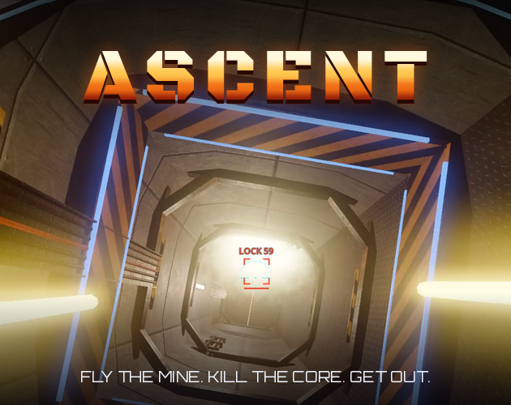
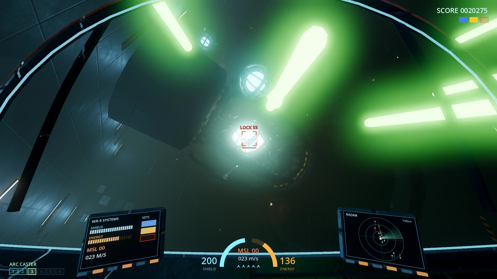
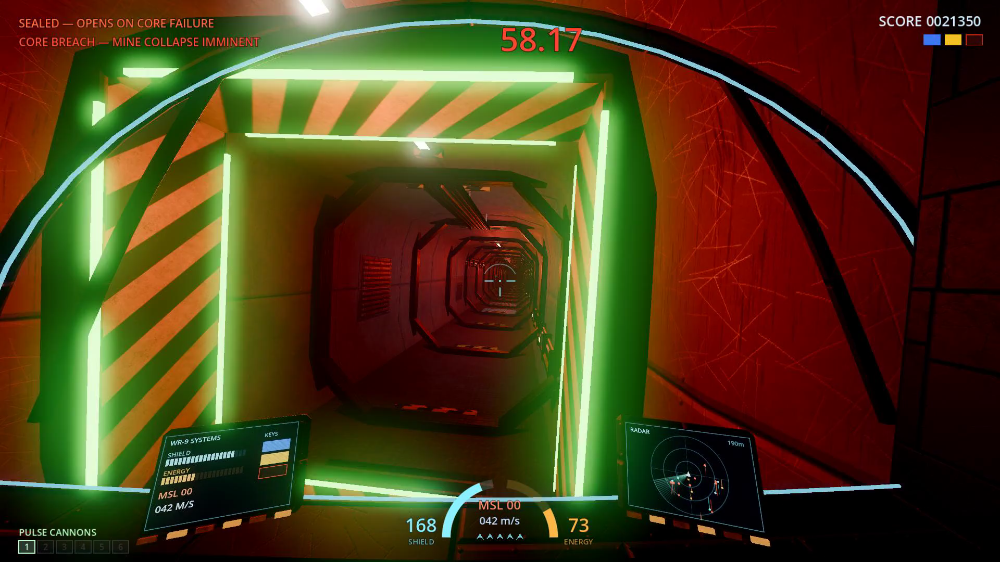
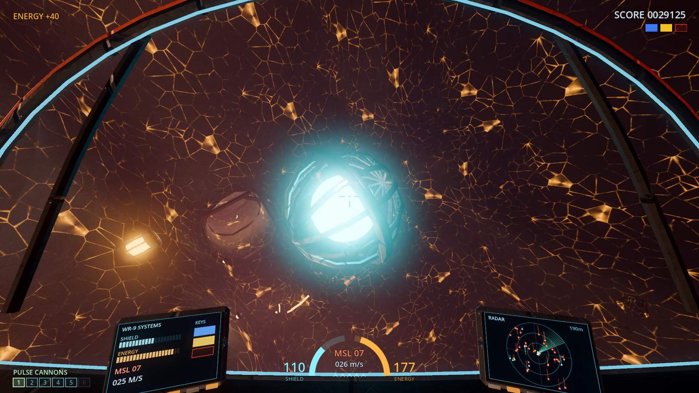
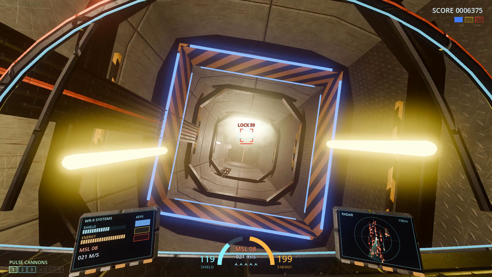
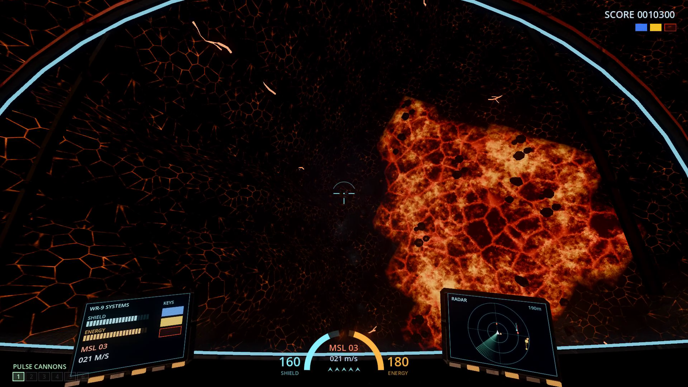

# Ascent

**Fly a gunship through hostile mines in full 6DOF. Kill rogue machines, blow the core, escape before it all comes down.**

An original six-degrees-of-freedom mine shooter for Godot 4.7. Every model, texture,
sound, song and level is generated from code.

| | |
| --- | --- |
|  |  |
|  |  |

- 10 mines, 19 robot types and 3 bosses, 6 primary weapons and 6 missile types
- Reactor escape sequences, rescuable survivors and secret rooms
- 11 narrated story scenes, 4 difficulties, keyboard/mouse or gamepad
- Builds for Linux, macOS and the web (`tools/refresh.sh linux macos web`)

Run it: `godot --path .` (or open the folder in the Godot editor and press F5).

A save is written automatically at the start of each level, as a new file every time
(`user://saves/`), so a level can have any number of saves. To add a level, write a
`tools/blender/layout_<id>.py`, build it with `level.py -- <id>`, and append it to `levels`
in `scripts/game.gd`.

Hidden in the mine are stranded astronauts: fly close to rescue them for bonus points.

**Goal:** find the coloured keys, reach the reactor (or, on level 7, the Overseer),
destroy it, then reach the escape tunnel within 60 seconds. Keys and doors set a
checkpoint, every 30,000 points earns another airframe, and four difficulties change
enemy damage, armour, fire rate, lives and score.

| Input | Action |
| --- | --- |
| Mouse / arrows | Pitch and yaw |
| W S / A D | Thrust / strafe |
| Space / Ctrl or C | Up / down |
| Q E | Roll |
| LMB | Pulse cannons |
| RMB | Fire selected missile |
| 1 to 6 | Select weapon |
| Wheel or G | Next missile type |
| Shift | Afterburner (uses energy) |
| F | Flare: lights the way and opens doors |
| Tab or M | Map of explored tunnels (drag to orbit, wheel to zoom) |
| V | Cycle chase / cockpit / clean view |
| R | Rear view (tap to toggle, hold to peek) |
| L | Headlight |
| Esc | Pause |

A standard gamepad also works (twin-stick flight). Upgrades are found in levels and carry forward.

Finishing a level unlocks the next in Select Level, and the Gallery fills in as levels unlock.

Mouse sensitivity, field of view, graphics quality, render scale, an FPS counter and separate music, effects and ambience volumes are under Settings.

## Rebuilding assets

`tools/build_assets.sh` regenerates everything in `assets/` from `tools/blender/`:
`kit.py` (modeling toolkit), `ship_player.py`, `robots.py`, `props.py`, `wall_parts.py`
(shared wall details, instanced by `scripts/wall_parts.gd`), `level.py` (layout, spawns and shell), `gen_textures.py`, `gen_audio.py` (effects), `gen_music.py`
(soundtrack; needs ffmpeg), both built on `synth.py`. Blender writes only geometry and
material names; `scripts/mats.gd` defines the real materials. Mine songs have matching
calm and combat stems, and `scripts/music.gd` raises the combat stem during fights.

## Tests

`godot --headless --path . res://tests/campaign.tscn` checks that all ten levels can be solved and won, `res://tests/weapons.tscn` exercises every weapon, enemy and mine, `res://tests/features.tscn` covers audio, difficulty, checkpoints and the map, and `res://tests/smoke.tscn` runs a full objective playthrough.

`res://tests/autoplay.tscn` has a bot play real levels through the normal controls and report wins, deaths, causes of death and frame times:

- Logic only: `godot --headless --path . res://tests/autoplay.tscn -- levels=all speed=4`
- On the GPU: `godot --path . --resolution 2560x1440 res://tests/autoplay.tscn -- levels=1,10 report=out.json shots=<dir>`
- Options: `difficulty=0-3`, `immortal=1`, `audio=1`, `hunt=0` (skip secrets), `max=<seconds>`

`godot --path . res://tests/shots.tscn -- <dir>` saves screenshots and frame rates.

`res://tests/turrets.tscn` checks every wall turret and tripwire can be seen, locked and hit, `res://tests/controls.tscn` covers rebinding, and `res://tests/tuner.tscn` covers the cockpit tuner.

## Cockpit tuner

Open `tools/cockpit_tuner.tscn` in the editor and press F6, or run `godot --path . res://tools/cockpit_tuner.tscn`. It shows level 1 with the real ship and cameras. The sliders change the cockpit and rear views live, and Save writes `assets/view_tuning.tres`, which the game reads. H hides the panel; F1 flies the ship to feel the motion.

## Recording

`godot --path . --write-movie out.avi --fixed-fps 30 res://tests/render_story.tscn -- <chapter>` records one story chapter (0 to 10). Screenshots and videos go to `docs/screenshots`, `docs/cutscenes` and `docs/gameplay`; they are large, so they are not in git.

## Refreshing docs and stats

`tools/refresh.sh <command...>` brings the generated docs up to date after a development phase; `tools/refresh.sh --help` lists every option.

- `tests`: runs every headless test suite (4 at a time) and prints pass/fail per suite.
- `stats`: the bot plays every level on all four difficulties (headless, 4 at a time) and writes `docs/stats/README.md` (time, deaths, damage, kills, energy and missiles used, missed pickups, secrets, rank, where deaths happened, change since the last run), `docs/stats/latest.json` and `docs/stats/history/<date>.json`. Use `--levels 1,2 --difficulties 1` for a partial run; it only replaces those rows.
- `screens` and `gallery`: re-take `docs/screenshots` under xvfb.
- `web`: Web export into `build/web` plus `build/ascent_web.zip`.
- `linux`, `macos`: a single-file Linux executable (`build/linux/Ascent.x86_64`) and a universal, ad-hoc signed macOS app (`build/macos/Ascent.zip`).
- `cutscenes`, `gameplay`: record the story chapters (`--chapters 0,6`) and the bot on level 1 (`--levels`) with Movie Maker into `docs/cutscenes` and `docs/gameplay`. These are heavy: run them when nothing else is using the CPU.
- `trailer`: a rough ~70 s trailer from those videos with title cards and `assets/music/ascent.ogg`, written to `docs/trailer/trailer.mp4`.
- `light` runs tests+stats, screens+gallery and web in parallel. `all` does the same, then records the videos one at a time and builds the trailer.

Add `--dry-run` to see the commands without running them. Logs go to `docs/stats/logs/<command>/`, and scratch files go to `.refresh_tmp/`. Each Godot run gets its own `user://`, so your own settings and saves are never touched.

## Story assets

- `tools/gen_voices.py` speaks every story line with a local Kokoro install (run it with a Python that has `kokoro_onnx`); clips go to `assets/voice/`.
- `tools/blender/harbor_ring.py` builds the home station; `gen_space.py -- asteroid` rebuilds the asteroid with its open mine shaft.
- Each level starts in its own spawn room with a sealed entry door behind it (`SPAWN_ROOMS` in `tools/blender/level.py`); the story shows the ship arriving through it.
- `res://tests/stage_preview.tscn -- <dir> <chapter>:<shot>:<share>` saves single frames of story shots for quick checks.
- `tools/blender/ship_concepts.py` builds alternative player ships for comparison; renders are in `docs/ship_concepts/`.
